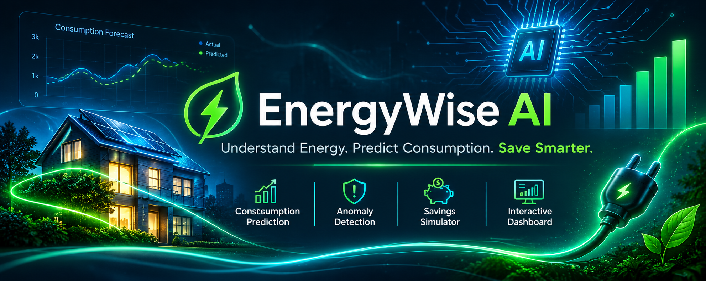

# ⚡ EnergyWise AI

  

<h3 align="center">
AI-Powered Energy Management & Optimization
</h3>

  
  
  
  
  

---

## 🌍 About the Project

EnergyWise AI is an intelligent energy management system designed to help users understand, predict, and optimize their electricity consumption.

The project combines Machine Learning, data analysis, and interactive visualization to forecast energy consumption, detect anomalies, and estimate potential energy savings.

## 🎯 Our Mission

To make electricity consumption more transparent, efficient, and accessible through artificial intelligence.

## 🚀 Key Features

### 📊 Energy Consumption Prediction

- Electricity consumption forecasting using XGBoost.
- Historical consumption analysis.
- Daily and hourly consumption patterns.
- Actual and predicted consumption comparison.

### 🔍 Anomaly Detection

- Isolation Forest algorithm.
- Unusual consumption detection.
- Unexpected energy usage alerts.

### ⚡ Energy Savings Simulator

- Potential energy savings calculation.
- Financial savings estimation.
- Interactive what-if scenarios.
- Appliance usage optimization.

### 📈 Interactive Dashboard

- Interactive charts.
- Consumption forecasts.
- Anomaly alerts.
- Energy savings visualization.

---

## 🧠 Technologies & Tools

| Technology | Purpose |
|---|---|
| Python | Core programming language |
| NumPy | Numerical calculations |
| Pandas | Data processing |
| Matplotlib | Data visualization |
| Scikit-learn | Machine Learning |
| XGBoost | Consumption prediction |
| Isolation Forest | Anomaly detection |
| Streamlit | Interactive dashboard |
| Joblib | Model storage |

---

## 📏 Model Evaluation

### Consumption Prediction

- MAE
- RMSE
- Baseline comparison

### Anomaly Detection

- Precision
- Recall
- F1-score
- Synthetic anomaly testing

### Energy Savings

- Estimated electricity savings (kWh).
- Estimated financial savings.

The dataset will be divided chronologically:

- Training: 70%
- Validation: 15%
- Testing: 15%

---

## 📅 Development Roadmap

- [x] Project concept
- [x] Algorithm selection
- [ ] Dataset collection
- [ ] Data exploration
- [ ] Data preprocessing
- [ ] Baseline model
- [ ] XGBoost training
- [ ] Isolation Forest implementation
- [ ] Energy Savings Simulator
- [ ] Dashboard development
- [ ] System integration
- [ ] Final testing
- [ ] Project presentation

---

## 👥 Development Team

| Role | Responsibility |
|---|---|
| Data Engineer | Data collection and preprocessing |
| ML Engineer | Consumption prediction |
| AI Engineer | Anomaly detection |
| Software Developer | Dashboard development |
| Research & Integration | Research, integration and testing |

---

## ⚠️ Project Limitations

The initial version focuses on household electricity consumption.

Energy savings are calculated estimates, not experimentally verified results.

Future versions may support schools, offices, and other facilities.

---

## 🔮 Future Development

- Real-time energy monitoring.
- Smart meter integration.
- Appliance-level consumption analysis.
- Personalized recommendations.
- Support for schools and offices.

---

  <strong>
  Understand Energy. Predict Consumption. Save Smarter.
  </strong>

---

<h3 align="center">
🚧 PROJECT CURRENTLY IN DEVELOPMENT
</h3>

  We are working on bringing EnergyWise AI to life.
   
  More updates coming soon...
    
  <strong>Stay tuned and check back later!</strong>

---

  Made with ⚡ by the EnergyWise AI Team

